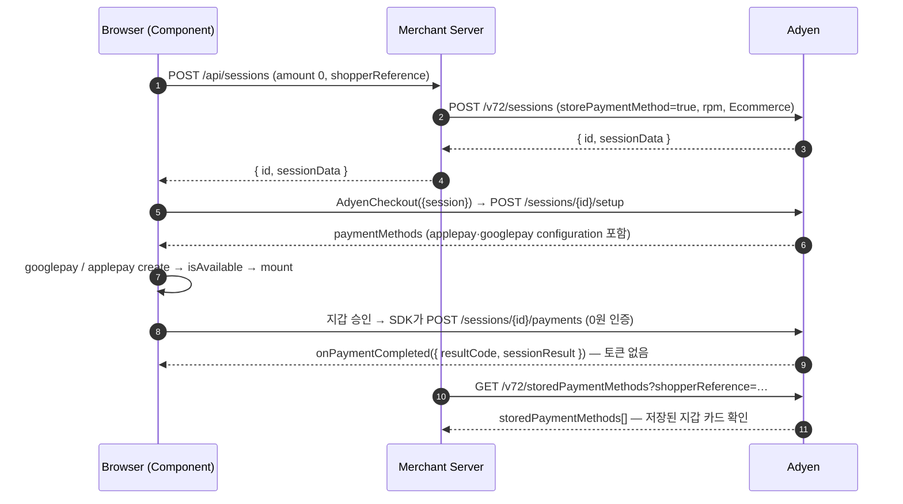

# Apple Pay / Google Pay 0원 인증 볼팅 — Sessions flow

0원 인증으로 Apple Pay와 Google Pay 결제수단을 저장(볼팅)하고 `storedPaymentMethodId`를 얻는 최소 구성을 정리한다. Sessions flow 기준이며, Apple Pay `recurringPaymentRequest`는 넣지 않는다.

- 기준: Checkout API **v72**, Adyen Web **5.72.0** (v5 UMD `AdyenCheckout`)
- 근거 코드: `SessionController.java`, `SessionService.java`, `static/js/wallet-sessions.js`, `static/js/shared.js`(`mountWallet`)
- 테스트 콘솔 위치: `http://localhost:8080` (단일 페이지)
- 아래 샘플은 콘솔 전용 코드(인스펙터, 목록 diff, 재마운트 처리)를 뺀 단순화 버전이다. 그대로 실행해 검증하지는 않았다.

## 흐름



## 1) Session API 요청

**`POST https://checkout-test.adyen.com/v72/sessions`**
헤더: `X-API-Key: <API key>`, `Content-Type: application/json`

```json
{
  "merchantAccount": "YOUR_MERCHANT_ACCOUNT",
  "amount": { "currency": "USD", "value": 0 },
  "reference": "WS-1760940000000",
  "returnUrl": "https://your.domain/return",
  "countryCode": "US",
  "channel": "Web",
  "shopperReference": "shopper-001",
  "storePaymentMethod": true,
  "recurringProcessingModel": "CardOnFile",
  "shopperInteraction": "Ecommerce"
}
```

| 필드 | 역할 |
|---|---|
| `amount.value: 0` | 0원 인증. 결제와 함께 저장하려면 양수를 넣는다 |
| `storePaymentMethod: true` | 결제수단 저장(볼팅)을 요청한다 |
| `shopperReference` | 저장 토큰의 주인. 이후 `GET /storedPaymentMethods` 조회와 후속 결제에 같은 값을 쓴다 |
| `recurringProcessingModel` | 저장 용도: `CardOnFile`, `Subscription`, `UnscheduledCardOnFile` |
| `shopperInteraction: "Ecommerce"` | 고객이 화면에 있는 결제(CIT)라는 표시 |
| `countryCode` | 지갑 노출과 결제수단 필터링에 쓰인다 |

응답의 `id`와 `sessionData`를 그대로 프론트에 넘긴다.

현재 서버 구현에서 이 요청을 만드는 곳은 `SessionService.createSession`이다. `storePaymentMethod=true`와 `shopperInteraction=Ecommerce`는 고정값이고, rpm은 값이 없으면 `CardOnFile`이 기본이다.

## 2) Adyen Component JS 호출

```html
<link rel="stylesheet" href="https://checkoutshopper-test.adyen.com/checkoutshopper/sdk/5.72.0/adyen.css" />
<script src="https://checkoutshopper-test.adyen.com/checkoutshopper/sdk/5.72.0/adyen.js"></script>

<div id="googlepay-container"></div>
<div id="applepay-container"></div>
```

```js
async function initWalletVaulting(shopperReference) {
  // 1. 서버에서 세션 생성 (위 1) 요청을 서버가 Adyen에 보냄)
  const res = await fetch('/api/sessions', {
    method: 'POST',
    headers: { 'Content-Type': 'application/json' },
    body: JSON.stringify({
      reference: 'WS-' + Date.now(),
      amount: 0,
      currency: 'USD',
      shopperReference,
      countryCode: 'US',
      recurringProcessingModel: 'CardOnFile',
    }),
  });
  const session = await res.json(); // { id, sessionData, ... }

  // 2. AdyenCheckout 생성: session만 넘기면 SDK가 /setup을 호출해 결제수단·설정을 가져옴
  const checkout = await AdyenCheckout({
    environment: 'test',
    clientKey: 'test_XXXXXXXX',
    session: { id: session.id, sessionData: session.sessionData },
    onPaymentCompleted: (result) => {
      // result.resultCode만 온다 (Authorised / Refused ...). storedPaymentMethodId는 콜백에 없다
      console.log('resultCode', result.resultCode);
    },
    onError: (err) => console.error(err),
  });

  // 3. Google Pay
  const googlePay = checkout.create('googlepay', { environment: 'TEST' });
  googlePay.isAvailable()
    .then(() => googlePay.mount('#googlepay-container'))
    .catch((e) => console.warn('Google Pay 사용 불가', e));

  // 4. Apple Pay (recurringPaymentRequest 없음)
  const applePay = checkout.create('applepay');
  applePay.isAvailable()
    .then(() => applePay.mount('#applepay-container'))
    .catch((e) => console.warn('Apple Pay 사용 불가', e));
}
```

- `onSubmit`을 **넘기지 않는다**. 넘기지 않으면 SDK가 `/sessions/{id}/payments`를 직접 호출하고, 넘기면 Sessions 자동 처리가 깨진다.
- amount, countryCode, 지갑 merchantId는 SDK가 `/setup` 응답에서 가져온다. `create()`에 다시 넣을 필요가 없다.

## 3) 볼팅 결과 확인

Sessions flow에서는 결제 요청을 SDK가 Adyen에 직접 보낸다. 그래서 서버는 `/payments` 응답을 받지 못하고, `onPaymentCompleted`에도 토큰이 없다. `storedPaymentMethodId`를 얻는 경로는 다음과 같다.

| 경로 | 현재 구현 | 비고 |
|---|---|---|
| `GET /v72/storedPaymentMethods?merchantAccount=…&shopperReference=…` | ✅ (`GET /api/stored-payment-methods`) | 콘솔이 완료 직후 자동 조회하고 새 카드에 🆕 표시. 토큰 생성이 비동기라 직후 조회에 안 보이면 잠시 뒤 다시 조회 |
| `GET /v72/sessions/{id}?sessionResult=…` | ✅ (`GET /api/sessions/{id}`) | 세션 상태 확인용. 토큰은 오지 않는다 |
| AUTHORISATION 웹훅 `additionalData.tokenization.storedPaymentMethodId` | ❌ | 서버에서 확정하려면 운영에서는 이 웹훅이 정답 경로다. HMAC 검증 필요 |
| `recurring.token.created` 웹훅 | ❌ | 토큰 생성 이벤트 |

후속 결제(저장 카드 결제)는 `POST /payments`에 `paymentMethod: { type: <목록의 type>, storedPaymentMethodId }`와 같은 `shopperReference`를 실어 보낸다. 이 저장소 범위 밖이다.

## 사전 조건과 제약

- **Allowed origins**: clientKey의 Allowed origins에 페이지 origin(예: `http://localhost:8080`)을 등록해야 한다. 등록 위치는 Customer Area → Developers → API credentials → Client settings다. 없으면 `/setup`이 403이 되고 브라우저에는 `Failed to fetch`로 보인다. 그 뒤 `create()`가 `Cannot read properties of undefined (reading 'paymentMethods')`로 실패한다(2026-10-20 실측).
- **Google Pay**: Chrome과, 카드가 등록된 Google 계정이 필요하다. TEST 환경은 localhost에서도 동작한다.
- **Apple Pay**: Safari, HTTPS, Adyen Customer Area 도메인 등록이 필요하다. localhost HTTP에서는 버튼이 뜨지 않으므로 터널(ngrok 등)을 쓰고, 그 도메인도 Allowed origins에 추가한다.
- **`recurringPaymentRequest`(Apple Pay)**: 선택값이다. 없으면 토큰이 기기 종속 DPAN 기반이 되고, 기기를 바꾸면 MIT가 실패할 수 있다. 정기결제라면 넣는 것을 권장한다(MPAN 발급). 이것 없이 $0 시트가 정상 표시되는지는 실기기 확인이 필요하다.
- **검증계 velocity**: 같은 카드로 연속 테스트하면 FRAUD로 오거절될 수 있다. 75초 간격을 둔다.

## 미확인 항목

- 실제 승인 뒤 `GET /sessions/{id}` 응답 내용
- 지갑 출처 저장 토큰의 `storedPaymentMethods[].type` 값(`scheme`인지 `applepay`/`googlepay`인지)
- 후속 결제의 `ContAuth + CardOnFile` 조합이 Adyen 기준에 맞는지(현재 코드 기본값)
